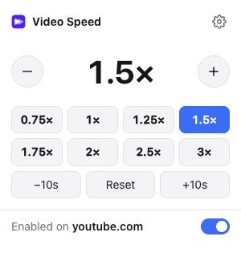
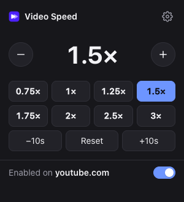
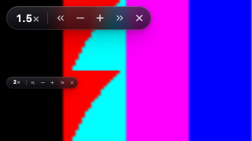
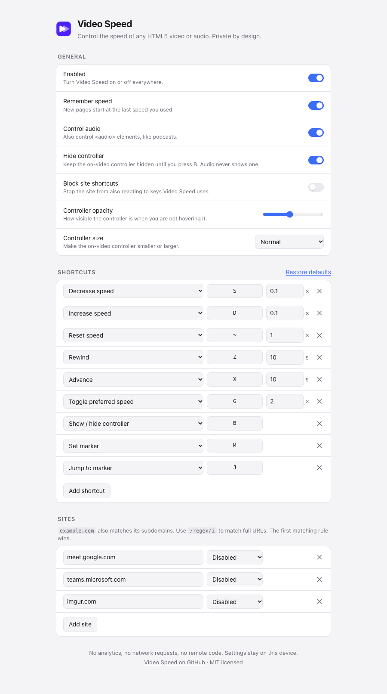

<p align="center">
  
</p>

<h1 align="center">Video Speed</h1>

<p align="center">
  Speed up, slow down, rewind and advance <b>any</b> HTML5 video or audio with your keyboard.<br />
  Modern, tiny, private. No tracking, no network, no dependencies.
</p>

<p align="center">
  
  
</p>

---

A ground-up rewrite of the much-loved [Video Speed Controller](https://github.com/igrigorik/videospeed) by [Ilya Grigorik](https://github.com/igrigorik), built for today's browsers. It keeps the same idea and the familiar shortcuts, with a much smaller and stricter codebase.

## Why

- **Private.** No analytics, no update pings, no remote code. The extension has no network code at all, and its own pages are locked down with `default-src 'none'`. Settings live in `chrome.storage.local` on your device and are never synced.
- **Secure.** It asks for one permission: `storage`. All code runs in the extension's **isolated world**, so pages cannot read its state, call its functions or spoof its messages. The on-video controller lives in a **closed** shadow root, and there are no web-accessible resources a site could use to fingerprint you. Everything read from storage is validated before use.
- **Simple.** About 900 lines of plain JavaScript. No framework, no bundler, no build step. What's in `extension/` is exactly what runs.
- **Fast.** It does nothing on pages without media. There is one shared overlay per frame, layout reads are batched into a single animation frame, and listeners are cleaned up when you turn the extension off.
- **Modern.** Manifest V3. The controller lives in the browser's top layer (`popover`), so it stays above site players and keeps working in fullscreen. The popup and settings pages follow your light or dark theme.

## Features

- Works on any site with `<video>` or `<audio>`: YouTube, Netflix, Coursera, podcasts, local files. It also finds media inside iframes and shadow DOM.
- Speeds from 0.07× to 16×, in steps you choose.
- **Speed fightback:** when a player quietly resets your speed, Video Speed puts it back. When *you* pick a speed in the site's own menu, Video Speed follows your choice.
- **Per-site rules:** set a default speed for a domain (say, 2× on lecture sites), or turn the extension off there. Matches domains plus subdomains, or `/regex/` on the full URL.
- **Remember speed** across pages (on by default).
- A draggable glass on-video controller: quick buttons on hover, adjustable opacity, four sizes (down to 50%). Hidden until you press <kbd>V</kbd>; audio never gets one. Speeds read cleanly: `1×`, `1.5×`, `1.25×`.
- A popup with presets, ±10s and reset, plus an on/off switch for the current site.
- Fully remappable shortcuts with modifier keys. You can add as many as you like (for example, a second preferred speed on Shift+G).

## Shortcuts

| Key | Action |
| --- | --- |
| <kbd>S</kbd> | Decrease speed (0.1×) |
| <kbd>D</kbd> | Increase speed (0.1×) |
| <kbd>~</kbd> | Reset to 1.0×; press again to return to your previous speed |
| <kbd>Z</kbd> | Rewind 10 seconds |
| <kbd>X</kbd> | Advance 10 seconds |
| <kbd>G</kbd> | Toggle preferred speed (2×) |
| <kbd>V</kbd> | Show or hide the on-video controller (hidden by default) |
| <kbd>M</kbd> | Set a marker at the current position |
| <kbd>J</kbd> | Jump back to the marker |

Shortcuts are matched by physical key, so they work on any keyboard layout. They are ignored while you type in text fields. Remap them on the settings page (right-click the toolbar icon, then **Options**). Changes apply right away, with no page reload. Play/pause and mute are also available as actions.

<p align="center"></p>
<p align="center"></p>

## Install

**From source (any Chromium browser: Chrome, Edge, Brave, Arc, Vivaldi):**

1. Clone this repo, or download and unzip it.
2. Open `chrome://extensions` and turn on **Developer mode**.
3. Click **Load unpacked** and select the `extension/` folder.
4. Optional: to control local files, open the extension's details and turn on **Allow access to file URLs**.

## Develop

```sh
pnpm install
pnpm test                               # unit tests (node:test)
pnpm exec playwright install chromium   # once
pnpm test:e2e                           # loads the real extension in Chromium
pnpm zip                                # dist/videospeed-<version>.zip for the Web Store
```

The end-to-end suite loads the unpacked extension into Chromium and tests the real thing:

- the default keys, seeking and markers
- typing in text fields doesn't trigger shortcuts
- the overlay sits above the page and above fullscreen content
- speed fightback, and following the site's own speed menu
- media in shadow DOM and in iframes
- popup messaging, the options page, and settings that apply live
- per-site rules and remembered speed
- nothing leaks into the page
- the browser makes **zero** requests outside the local test server

The unit suite also scans the source for network APIs and checks the manifest's permissions.

### Layout

```
extension/
  manifest.json   MV3 manifest: one permission, strict CSP
  lib.js          pure logic: settings validation, site rules, key matching, speed math
  content.js      finds media, handles shortcuts, enforces speed, draws the overlay
  popup.*         toolbar popup
  options.*       settings page
  ui.css          shared design tokens (light + dark)
test/
  unit.test.cjs   node:test unit tests for lib.js + privacy checks
  e2e.test.mjs    Playwright end-to-end tests
```

## Known limits

- When the `<video>` element *itself* is fullscreen (rather than its player container), the controller still shows, but only the keyboard works: the browser blocks clicks on anything outside a fullscreen element. Most sites fullscreen the player container, where the controller works fully.
- Browser-internal pages (`chrome://`, the Web Store) don't allow extensions.
- Seeking on Netflix with <kbd>Z</kbd>/<kbd>X</kbd> may be rejected by Netflix's player. Speed control works.

## Credits

Video Speed stands on the shoulders of **[Video Speed Controller](https://github.com/igrigorik/videospeed)** by **[Ilya Grigorik](https://github.com/igrigorik)** and its many contributors. Since 2014 it has shown how useful a speed control on every video can be. The idea, the default shortcuts and the "speed fightback" concept come from that project. This is an independent rewrite and is not affiliated with or endorsed by the original authors. Both projects are MIT licensed.

## License

[MIT](LICENSE) © 2026 [Ahmad Awais](https://github.com/ahmadawais). Original Video Speed Controller © 2014 Ilya Grigorik.
